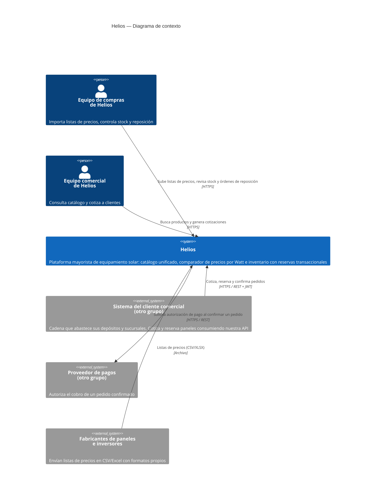

# Arquitectura — Helios

Plataforma mayorista de equipamiento solar. Este documento describe la
arquitectura del sistema: qué servicios hay, de qué es dueño cada uno, cómo se
comunican y cómo se distribuyen los componentes.

- **Estado:** Entrega 1 (diseño y contrato con mock) — 9 de octubre de 2026
- **Decisiones registradas:** [`adr/`](adr/)
- **Alcance y reglas de negocio:** [`../SPEC.md`](../SPEC.md)
- **Contrato publicado:** [`contracts/`](contracts/)

---

## 1. Qué hace el sistema

Helios es un mayorista: compra equipamiento solar a varios fabricantes y lo
revende a clientes comerciales. El negocio se sostiene sobre tres capacidades
que el software tiene que resolver bien:

1. **Unificar catálogos heterogéneos.** Cada fabricante manda su lista de precios
   en su propio formato, con sus propios códigos y su propio criterio de
   nomenclatura. Sin unificación no hay catálogo comparable.
2. **Comparar costos de forma significativa.** Un panel de 550 W a USD 100 y uno
   de 580 W a USD 110 no se comparan por precio: se comparan por **costo por
   Watt**, después de bonificaciones, flete e impuestos.
3. **Comprometer stock sin equivocarse.** Un pallet reservado dos veces es un
   pedido que no se puede cumplir. La reserva es la operación crítica.

La acción principal del dominio es **reservar un pedido mayorista contra una
cotización vigente**: una operación transaccional multi-línea, con bloqueo de
inventario, cupos por cliente, precio congelado, vencimiento y generación
automática de órdenes de reposición. Las reglas completas están en
[`../SPEC.md`](../SPEC.md).

---

## 2. Diagrama de contexto (C4 — nivel 1)



**Integración entre grupos.** Helios es a la vez proveedor y consumidor:

| Rol | Contraparte | Qué se intercambia | Dónde vive la integración |
|---|---|---|---|
| **Proveedor** | Sistema del cliente comercial | Cotización y reserva de equipamiento solar | Contrato en [`contracts/openapi.yaml`](contracts/openapi.yaml), servido por `pricing-search-service` y `stock-service` |
| **Consumidor** | Proveedor de pagos | Autorización del cobro de un pedido confirmado | Adaptador dentro de `stock-service`, el servicio dueño de la confirmación |

La llamada al proveedor de pagos sale de `stock-service`, **no** del frontend ni
del gateway: es el servicio responsable de la funcionalidad que usa esa
capacidad. La integración está en el camino crítico del negocio — sin
autorización de pago el pedido no pasa a `confirmado`.

---

## 3. Diagrama de contenedores (C4 — nivel 2)

```mermaid
C4Container
  title Helios — Diagrama de contenedores

  Person(usuario, "Usuarios de Helios", "Compras y comercial")
  System_Ext(cliente, "Sistema del cliente<br/>(grupo consumidor)")
  System_Ext(pagos, "Proveedor de pagos<br/>(grupo proveedor)")
  System_Ext(fabricantes, "Fabricantes")

  Container_Boundary(helios, "Helios") {
    Container(front, "Frontend web", "SPA", "Interfaz única del sistema: catálogo, cotizaciones, importaciones, stock y reposición")
    Container(gw, "API Gateway", "Kong 3.8 (DB-less)", "Punto de entrada único: enrutamiento, JWT, rate limiting, balanceo con health checks y correlación de pedidos")

    Container(import, "import-service", "Node.js — pipeline por etapas", "Ingesta y normaliza listas de precios de fabricantes con formatos heterogéneos")
    Container(catalog, "catalog-service", "Node.js — capas", "Catálogo canónico de productos y mapeo de SKUs por fabricante")
    Container(precios, "pricing-search-service", "Node.js — CQRS", "Calcula costo por Watt, rankea fabricantes y resuelve búsquedas facetadas. Dos instancias")
    Container(stock, "stock-service", "Node.js — hexagonal + DDD", "Inventario, reservas transaccionales, cupos y órdenes de reposición")

    ContainerDb(mongo, "MongoDB", "mongo:7", "Lotes de importación, filas crudas y perfiles de mapeo")
    ContainerDb(pgcat, "PostgreSQL — catálogo", "postgres:16", "Productos, fabricantes, mapeos de SKU, outbox")
    ContainerDb(pgstock, "PostgreSQL — stock", "postgres:16", "Existencias, reservas, movimientos, órdenes de reposición, idempotencia")
    ContainerDb(es, "Elasticsearch", "8.15", "Índice de búsqueda: read model desnormalizado por producto")
    ContainerDb(redis, "Redis", "redis:7", "Caché de consultas de catálogo y de cotizaciones")
    Container(mq, "RabbitMQ", "3.13", "Exchange helios.eventos + colas por consumidor + DLQ")
    Container(mock, "Mock del contrato", "Prism 4", "Sirve openapi.yaml con ejemplos para que el grupo consumidor se integre antes de la implementación real")
  }

  Rel(usuario, front, "Usa", "HTTPS")
  Rel(front, gw, "Llama", "HTTPS/JSON + JWT")
  Rel(cliente, gw, "Cotiza y reserva", "HTTPS/JSON + JWT")
  Rel(fabricantes, front, "Listas de precios", "CSV/XLSX")

  Rel(gw, import, "/interno/importaciones/**", "HTTP")
  Rel(gw, catalog, "/interno/catalogo/**", "HTTP")
  Rel(gw, precios, "/v1/proveedor/catalogo, /v1/proveedor/cotizaciones", "HTTP — balanceado")
  Rel(gw, stock, "/v1/pedidos/**, /v1/proveedor/disponibilidad", "HTTP")
  Rel(gw, mock, "/mock/**", "HTTP")

  Rel(import, mongo, "Lee y escribe", "MongoDB wire")
  Rel(catalog, pgcat, "Lee y escribe", "SQL")
  Rel(stock, pgstock, "Transacciones", "SQL")
  Rel(precios, es, "Indexa y consulta", "HTTP")
  Rel(precios, redis, "Cache-aside", "RESP")

  Rel(import, catalog, "Resuelve SKUs al aplicar un lote", "HTTP síncrono")
  Rel(stock, precios, "Recupera cotización y ranking de fabricantes", "HTTP síncrono, timeout + circuit breaker")
  Rel(stock, pagos, "Autoriza el pago del pedido", "HTTPS síncrono, timeout + reintento idempotente")

  Rel(import, mq, "Publica precios.lista_actualizada", "AMQP")
  Rel(catalog, mq, "Publica catalogo.producto_catalogado", "AMQP")
  Rel(stock, mq, "Publica stock.*, pedido.*", "AMQP")
  Rel(mq, precios, "Entrega eventos a la proyección", "AMQP")
  Rel(mq, stock, "Entrega catalogo.producto_catalogado", "AMQP")

  UpdateLayoutConfig($c4ShapeInRow="3", $c4BoundaryInRow="1")
```



---

## 4. Servicios: responsabilidad y propiedad de los datos

El criterio de separación es **propiedad de los datos**: cada servicio es el
único que escribe en su base y el único que puede responder autoritativamente
sobre su parte del dominio. Nadie lee la base de otro. El razonamiento completo
está en [`adr/ADR-001-limites-de-servicios.md`](adr/ADR-001-limites-de-servicios.md).

### 4.1 `import-service`

| | |
|---|---|
| **Responsabilidad** | Convertir las listas de precios de los fabricantes, con formatos distintos cada una, en filas canónicas listas para el catálogo. |
| **Dueño de** | Lotes de importación, filas crudas tal como llegaron, filas normalizadas, perfiles de mapeo por fabricante y versión. |
| **No decide sobre** | Qué es un producto (eso es de `catalog-service`) ni cuánto cuesta puesto en destino (eso es de `pricing-search-service`). |
| **Persistencia** | MongoDB — las planillas no tienen esquema fijo y cambian sin aviso. |
| **Patrón interno** | Pipeline por etapas: ingesta → parseo → normalización → validación → publicación. |
| **Publica** | `precios.lista_actualizada` |
| **Consume (síncrono)** | `catalog-service` para resolver códigos de fabricante a SKU canónico. |

La regla de negocio dura de este servicio: **una lista con más del 10 % de filas
con error se rechaza completa**. Aplicar media lista deja el comparador peor que
no haber importado nada, porque los productos que entraron compiten contra
precios viejos de los que no entraron.

### 4.2 `catalog-service`

| | |
|---|---|
| **Responsabilidad** | Definir qué productos existen y unificar los códigos de los distintos fabricantes contra un SKU canónico. |
| **Dueño de** | Productos, fabricantes, certificaciones, unidad de embalaje, mapeos de SKU. |
| **No decide sobre** | Precios ni disponibilidad. |
| **Persistencia** | PostgreSQL — modelo relacional estable con integridad referencial estricta. |
| **Patrón interno** | Capas (http → aplicación → persistencia). |
| **Publica** | `catalogo.producto_catalogado`, `catalogo.mapeo_creado` |

El SKU canónico es el identificador que ve el mundo exterior: una vez publicado
no se recalcula nunca, porque el grupo consumidor lo tiene guardado en sus
propios pedidos.

### 4.3 `pricing-search-service`

| | |
|---|---|
| **Responsabilidad** | Calcular el costo unitario final, rankear fabricantes por costo por Watt, resolver búsquedas facetadas y emitir cotizaciones firmes. |
| **Dueño de** | El índice de búsqueda, la caché de consultas y las cotizaciones emitidas. |
| **No es dueño de** | Ningún dato de origen: todo lo que sirve es derivado. |
| **Persistencia** | Elasticsearch (índice) + Redis (caché). |
| **Patrón interno** | CQRS: proyección por eventos del lado escritura, consulta del lado lectura. |
| **Consume (eventos)** | `precios.lista_actualizada`, `catalogo.producto_catalogado`, `stock.existencia_cambiada` |
| **Instancias** | **Dos**, detrás del balanceador del gateway. |

Es el servicio elegido para replicar porque es el de lectura intensiva y el único
sin estado propio irrecuperable: si una instancia se cae, la otra responde con el
mismo índice.

### 4.4 `stock-service`

| | |
|---|---|
| **Responsabilidad** | Saber cuánto hay, comprometerlo sin sobreventa y disparar la reposición. Es el dueño del ciclo de vida del pedido. |
| **Dueño de** | Existencias por producto y depósito, reservas y sus líneas, libro mayor de movimientos, órdenes de reposición, claves de idempotencia, cupos por cliente. |
| **Persistencia** | PostgreSQL — es la operación que necesita ACID. |
| **Patrón interno** | Hexagonal (puertos y adaptadores) + DDD táctico. |
| **Publica** | `pedido.reservado`, `pedido.confirmado`, `pedido.expirado`, `stock.bajo_minimo`, `stock.existencia_cambiada` |
| **Consume (síncrono)** | `pricing-search-service` (cotización y ranking) y el **proveedor externo de pagos**. |

`producto_id` y `sku` aparecen en las tablas de este servicio sin clave foránea:
son una réplica de la identidad que define `catalog-service`, mantenida por
eventos. Es el costo aceptado de no compartir base.

---

## 5. Comunicación entre servicios

Detalle y justificación en
[`adr/ADR-005-comunicacion.md`](adr/ADR-005-comunicacion.md).

### 5.1 Síncrono — cuando el que pregunta no puede seguir sin la respuesta

| Origen → destino | Para qué | Timeout | Reintentos | Si falla |
|---|---|---|---|---|
| `stock-service` → `pricing-search-service` | Recuperar la cotización al reservar | 2 s | 1, sólo en error de red o 5xx | `503` al consumidor. Sin precio firme no hay reserva posible. |
| `stock-service` → `pricing-search-service` | Ranking de fabricantes para la reposición | 2 s | 1 | La orden se registra con `origen_del_precio = sin_ranking`. **No aborta la reserva.** |
| `stock-service` → proveedor de pagos | Autorizar el cobro | 2 s | 2, con la misma clave de idempotencia | El pedido queda `pendiente_de_pago` conservando el stock. |
| `import-service` → `catalog-service` | Resolver código de fabricante a SKU | 3 s | 2 | El lote queda en `normalizado` y se reanuda. |

Las dos llamadas de `stock-service` a `pricing-search-service` son al mismo
servicio pero con criterios de degradación **opuestos**, y eso es deliberado: la
cotización es esencial para la operación, el ranking de reposición es
conveniencia. Mezclarlos haría que una falla secundaria tire abajo la operación
crítica.

Toda llamada síncrona lleva timeout, circuit breaker (abre a las 5 fallas
consecutivas, half-open a los 30 s) y propaga `X-Correlation-Id`.

### 5.2 Asíncrono — cuando el emisor no necesita esperar

Exchange `helios.eventos` de tipo `topic`, una cola por consumidor y una DLQ
compartida `helios.eventos.dlq`.

```
import-service   --precios.lista_actualizada-->     [helios.eventos]
catalog-service  --catalogo.producto_catalogado-->  [helios.eventos]
stock-service    --stock.*, pedido.*-->             [helios.eventos]

[helios.eventos] --> cola precios.proyeccion   --> pricing-search-service
                 --> cola stock.catalogo       --> stock-service
                 --> (3 fallos) --> helios.eventos.dlq
```

Garantías:

- **Entrega al menos una vez**, con consumidores **idempotentes**: cada evento
  trae `id_mensaje`, que se registra antes de aplicar el efecto
  (`evento_consumido` en PostgreSQL y en MongoDB, con TTL de 7 días).
- **Publicación sin pérdida** mediante **outbox transaccional**: el evento se
  escribe en la tabla `outbox_evento` dentro de la misma transacción que el
  cambio de estado, y un publicador lo envía después con `publisher confirms`.
  Si RabbitMQ está caído, el evento espera; no se pierde.
- **Mensajes no procesables**: 3 intentos con backoff y luego la DLQ, con el
  motivo. Un mensaje envenenado no bloquea la proyección.

### 5.3 Catálogo de eventos de dominio

| Evento | Emisor | Consumidores | Efecto |
|---|---|---|---|
| `precios.lista_actualizada` | `import-service` | `pricing-search-service` | Reproyecta los productos del fabricante con los precios nuevos. |
| `catalogo.producto_catalogado` | `catalog-service` | `pricing-search-service`, `stock-service` | Alta del producto en el índice y de su existencia inicial. |
| `stock.existencia_cambiada` | `stock-service` | `pricing-search-service` | Actualiza `unidades_libres` en el índice. |
| `stock.bajo_minimo` | `stock-service` | `stock-service` (job de reposición) | Genera o actualiza la orden de reposición. |
| `pedido.reservado` / `pedido.confirmado` / `pedido.expirado` | `stock-service` | `pricing-search-service`, observabilidad | Libera o consolida disponibilidad proyectada. |

Formato: envoltorio tipo CloudEvents con `id_mensaje`, `tipo`, `ocurrido_en`,
`clave_agregado`, `correlation_id` y `datos`.

---

## 6. Búsqueda

- **Motor:** Elasticsearch 8.15, un índice `helios-productos` con un documento
  por producto canónico y las ofertas de cada fabricante anidadas y ya resueltas
  a costo por Watt.
- **Paginación:** `pagina` / `tamanio_pagina` (máximo 100).
- **Filtros de dominio:** tipo, fabricante, rango de potencia, tecnología de
  celda, costo por Watt máximo, sólo disponibles.
- **Ordenamiento:** `costo_por_watt_asc` (por defecto), `costo_por_watt_desc`,
  `potencia_w_desc`, `relevancia`.
- **Facetas:** conteos por fabricante y tecnología, para que el consumidor pueda
  construir filtros sin adivinar qué valores existen.

**Sincronización.** El índice se actualiza **ante cada cambio en los datos
fuente**, consumiendo eventos de dominio. Una búsqueda nunca dispara trabajo de
indexación.

**Retraso máximo tolerable: 60 segundos** entre el commit en el servicio dueño y
la aparición del cambio en los resultados. Se mide con
`helios_retraso_indice_segundos` (`proyectado_en` menos `ocurrido_en` del
evento) y se alerta si el p99 lo supera. El dato se expone al consumidor en la
cabecera `X-Indice-Actualizado-En`.

Elegimos 60 s porque las listas de precios se actualizan a lo sumo unas veces
por día, pero el stock cambia con cada reserva: un minuto de desfasaje en
`unidades_libres` es tolerable en una búsqueda **porque el valor autoritativo se
vuelve a verificar bajo lock en el momento de reservar**. El índice informa; no
decide.

**Reconstrucción.** `POST /interno/indice/reconstruir` reindexa desde cero contra
un índice nuevo y lo expone con un alias al terminar. Es el plan para cambios de
mapping y para recuperarse de eventos perdidos.

---

## 7. Caché

Cache-aside en Redis sobre el flujo de lectura más pesado: la búsqueda de
catálogo.

| | |
|---|---|
| **Qué se guarda** | La respuesta completa de `GET /v1/proveedor/catalogo`, con clave normalizada (parámetros ordenados, minúsculas y vacíos descartados). |
| **Vigencia** | TTL de 60 s, igual al retraso tolerable del índice: la caché no puede ser más vieja que lo que el índice ya admite. |
| **Invalidación** | Por TTL, más borrado del prefijo `busqueda:v1:` cuando la proyección reindexa un fabricante completo. |
| **Ante falla de Redis** | Se degrada a consultar Elasticsearch directo. Un fallo de caché **nunca** convierte una lectura en un error. |
| **Cómo se mide** | `helios_cache_busqueda_total{resultado="hit"|"miss"}` y la cabecera `X-Cache` en cada respuesta. |

La justificación es observable, no formal: la búsqueda del catálogo concentra el
tráfico de lectura (es lo primero que hace el consumidor y lo que el frontend
consulta en cada filtro), y las consultas se repiten mucho porque los filtros
usados son pocos. La medición comparativa antes/después se presenta en la
Entrega 2 con las pruebas de carga.

---

## 8. Consistencia y concurrencia

La única operación con garantías estrictas es la **reserva**. Todo lo demás
tolera consistencia eventual.

```
┌─ transacción (READ COMMITTED) ──────────────────────────────────┐
│ 1. SELECT ... FOR UPDATE sobre las existencias implicadas,       │
│    SIEMPRE ordenadas por (producto_id, deposito_id)   ← no deadlocks
│ 2. Validar las 6 reglas de negocio sobre datos ya bloqueados     │
│ 3. INSERT reserva + reserva_linea                                │
│ 4. UPDATE existencia.cantidad_reservada += cantidad              │
│ 5. INSERT movimiento_stock (libro mayor, append-only)            │
│ 6. INSERT orden_reposicion si cruzó el punto de reposición       │
│ 7. INSERT outbox_evento (los eventos de dominio)                 │
│ 8. INSERT clave_idempotencia  ← PRIMARY KEY: no hay duplicados   │
└─ COMMIT (todo) / ROLLBACK (nada) ───────────────────────────────┘
```

Lo que garantiza cada mecanismo:

| Riesgo | Mecanismo | Por qué alcanza |
|---|---|---|
| Sobreventa | `SELECT ... FOR UPDATE` + `CHECK (cantidad_reservada <= cantidad_fisica)` | El lock serializa las reservas concurrentes sobre el mismo producto; el CHECK lo vuelve imposible incluso ante un bug de aplicación. |
| Deadlock | Orden de bloqueo fijo por `(producto_id, deposito_id)` | Dos pedidos con las mismas líneas en orden distinto no pueden esperarse mutuamente. |
| Pedido duplicado | `Idempotency-Key` con `PRIMARY KEY`, insertada en la misma transacción | Un reintento del consumidor no puede crear una segunda reserva: la segunda inserción falla. |
| Reserva a medias | Transacción única para los 8 pasos | No existe un estado intermedio observable. |
| Evento perdido | Outbox transaccional | El evento se commitea con el cambio; el broker puede estar caído. |
| Evento aplicado dos veces | `evento_consumido` + `id_mensaje` | El consumidor es idempotente. |
| Stock bloqueado para siempre | `expira_en` + job de expiración | Una reserva sin confirmar libera el stock a los 15 minutos. |

`READ COMMITTED` alcanza: la exclusión mutua la da el `FOR UPDATE` explícito, no
el nivel de aislamiento. Subir a `SERIALIZABLE` agregaría reintentos por fallo de
serialización sin ganar ninguna garantía que no tengamos ya.

---

## 9. Resiliencia

| Dependencia de | Si falla o se pone lenta | Mecanismo |
|---|---|---|
| `stock-service` → `pricing-search-service` (cotización) | `503` con `Retry-After`; la reserva no se intenta sin precio firme | Timeout 2 s, 1 reintento, circuit breaker |
| `stock-service` → `pricing-search-service` (ranking de reposición) | La orden se registra sin fabricante elegido | Degradación controlada: `origen_del_precio = sin_ranking` |
| `stock-service` → proveedor de pagos | El pedido queda `pendiente_de_pago` **conservando el stock reservado** | Timeout, reintento idempotente, circuit breaker; el usuario ve "pago en verificación" |
| `pricing-search-service` → Redis | Se consulta Elasticsearch directo | La caché nunca es obligatoria |
| `pricing-search-service` → Elasticsearch | `503` en búsqueda; `/v1/proveedor/disponibilidad` sigue funcionando porque va contra `stock-service` | El consumidor tiene un camino alternativo para verificar stock |
| `import-service` → `catalog-service` | El lote queda en `normalizado` y se reanuda después | El pipeline es reanudable por etapas |
| Cualquier servicio → RabbitMQ | Los eventos acumulan en el outbox y se publican al volver | Outbox transaccional |
| Una instancia de `pricing-search-service` | El gateway la saca del anillo en ~10 s | Health checks activos cada 5 s sobre `/salud/viva`, 2 fallos para marcar caída |

La caída provocada y su análisis van en `docs/POSTMORTEM.md` (jornada de fallas
controladas, previa a la presentación).

---

## 10. Balanceo de carga

`pricing-search-service` corre en **dos instancias** (`pricing-search-1` y
`pricing-search-2`) y el tráfico se reparte en dos planos distintos:

- **Norte-sur (desde el gateway):** upstream `precios-upstream` de Kong,
  round-robin, con health checks **activos** cada 5 s sobre `/salud/viva` y
  pasivos sobre el tráfico real. Dos fallos consecutivos sacan la instancia del
  anillo; un éxito la devuelve.
- **Este-oeste (entre servicios):** las dos instancias comparten el alias de red
  `precios-interno`, así que el DNS de Docker reparte las llamadas internas sin
  pasar por el gateway. El tráfico interno no debe atravesar el punto de entrada
  público.

Cada respuesta lleva la cabecera `X-Instancia`, que es la evidencia directa de
la distribución. El estado por instancia se expone en las métricas del gateway
(`http://localhost:8100/metrics`, con `upstream_health_metrics` activado).

---

## 11. Observabilidad

**Logs estructurados.** JSON en todos los servicios (pino), con `servicio`,
`instancia`, `version`, `nivel` y `correlation_id` en cada línea. El gateway
genera `X-Correlation-Id` y los servicios lo propagan; una operación se sigue de
punta a punta grepeando un solo identificador. Los sondeos de salud se loguean
en `silent` para no tapar el tráfico real.

**Métricas.** Endpoint `/metricas` en formato Prometheus por servicio, más las
del gateway en `:8100/metrics`. Series que importan:

| Métrica | Para qué |
|---|---|
| `helios_cache_busqueda_total{resultado}` | Justificar la caché con datos (D7) |
| `helios_retraso_indice_segundos` | Verificar el retraso tolerable del índice (D6) |
| `helios_reservas_total{resultado}` | Volumen y tasa de rechazo por regla de negocio |
| `helios_dependencia_duracion_segundos{dependencia}` | Latencia de las llamadas salientes |
| `helios_circuito_estado{dependencia}` | Circuit breakers abiertos (D10) |
| `kong_upstream_target_health` | Qué instancias están en el anillo (D12) |

**Trazas.** Primera traza distribuida del flujo principal en la Entrega 2,
propagando el contexto desde el gateway.

**Tablero y alertas** se definen con D11 en la Entrega 2.

---

## 12. Patrones internos: dos estilos reconocibles

El enunciado pide al menos dos servicios con patrones de arquitectura interna
distintos. Tenemos tres, y cada elección responde al problema del servicio:

| Servicio | Patrón | Por qué ahí |
|---|---|---|
| `stock-service` | **Hexagonal + DDD táctico** | Es el servicio con las reglas más densas y la operación crítica. Aislar el dominio permite testear las seis reglas de la reserva sin levantar PostgreSQL, y cambiar el adaptador del proveedor de pagos (que es de otro grupo y puede cambiar) sin tocar una regla. |
| `pricing-search-service` | **CQRS con read model** | No es dueño de ningún dato: todo es derivado. Separar proyección de consulta permite responder búsquedas facetadas sin llamar a los otros servicios y escalar la lectura por separado. |
| `import-service` | **Pipeline por etapas** | El trabajo es una transformación de varios pasos donde cada paso falla por sus propias razones y hay que reanudar desde donde se cortó. El estado del lote dice en qué etapa está. |
| `catalog-service` | **Capas** | Modelo relacional estable con invariantes que la base ya garantiza. Un hexágono sería ceremonia sin beneficio, y decirlo explícitamente es parte de la decisión. |

---

## 13. Distribución y despliegue

**Local.** Un solo comando: `docker compose up --build`. Levanta los 4 servicios
(5 contenedores, porque `pricing-search` va doble), 5 almacenes, RabbitMQ, el
gateway y el mock del contrato. Sin pasos manuales previos: todas las variables
tienen default de desarrollo.

```
host
 ├── :8000  API Gateway (Kong)      ← punto de entrada único
 ├── :8001  Kong Admin API          (sólo local)
 ├── :8100  Kong status/métricas
 ├── :4010  Mock del contrato (Prism)
 ├── :3001  import-service
 ├── :3002  catalog-service
 ├── :3003  pricing-search-1   ─┐
 ├── :3013  pricing-search-2   ─┴─ balanceadas en el gateway
 ├── :3004  stock-service
 ├── :5433  PostgreSQL catálogo
 ├── :5434  PostgreSQL stock
 ├── :27017 MongoDB
 ├── :9200  Elasticsearch
 ├── :6379  Redis
 └── :5672 / :15672  RabbitMQ + consola
```

Los puertos de los servicios se publican al host sólo para depuración; el tráfico
de la aplicación entra siempre por `:8000`.

**Nube.** La capacidad pública (`/v1/**`) se despliega con una URL accesible y se
mantiene operativa hasta el final de la evaluación, según exige la consigna de
integración. El detalle de proveedor y pipeline se decide y documenta en la
Entrega 2.

---

## 14. Limitaciones conocidas y deuda técnica aceptada

Esta sección se mantiene actualizada durante todo el proyecto.

### Alcance de la Entrega 1

| Componente | Estado hoy |
|---|---|
| Contrato público + mock operativo | **Listo** |
| Esquemas de base de datos de los 4 servicios | **Listos**, con datos de demostración |
| Reglas de negocio de la reserva | **Implementadas y testeadas** (dominio puro) |
| Cálculo de costo por Watt y ranking de fabricantes | **Implementados y testeados** |
| Normalización de listas de precios | **Implementada y testeada** |
| Adaptadores de persistencia, mensajería y HTTP saliente | Pendientes — Entrega 2 |
| Endpoints del contrato | `GET /v1/proveedor/disponibilidad` responde contra la base real; el resto, `501` con `problem+json` apuntando al mock |
| Frontend | Pendiente — presentación grupal |
| Trazas distribuidas y tablero | Pendientes — Entrega 2 |
| Pruebas de carga y de contrato | Pendientes — Entrega 2 |

Los endpoints devuelven `501` a propósito: preferimos que el consumidor vea
"esto todavía no existe, usá el mock" antes que datos inventados por el servicio
real, que serían indistinguibles de una implementación con bugs.

### Deuda asumida conscientemente

1. **`producto_id` replicado en `stock-service` sin clave foránea.** Es el precio
   de no compartir base. Mitigación: la identidad llega por evento y el SKU es
   inmutable una vez publicado.
2. **El índice de búsqueda es eventualmente consistente.** `unidades_libres` en
   un resultado puede estar hasta 60 s atrasado. Aceptable porque el valor
   autoritativo se revalida bajo lock al reservar.
3. **Sin paquete de código compartido entre servicios.** `observabilidad.js`,
   `salud.js`, `problema.js` y `sondas.js` están duplicados en los cuatro. Es
   intencional para no acoplar los despliegues en esta etapa; si la duplicación
   empieza a divergir, se extrae a un paquete versionado y se registra el cambio.
4. **Kong en modo DB-less con `rate-limiting` de política local.** El límite es
   por nodo, no global. Con un solo nodo de gateway no cambia nada; con varios
   habría que pasar a Redis como backend del contador.
5. **Elasticsearch de un solo nodo, sin seguridad.** Apropiado para desarrollo;
   el despliegue en nube necesita autenticación y al menos una réplica.
6. **Las cotizaciones viven en `pricing-search-service` sin persistencia durable
   todavía.** Se resuelve en la Entrega 2 decidiendo si van a Redis con TTL o a
   una tabla propia; afecta qué pasa con una cotización si el servicio reinicia.
